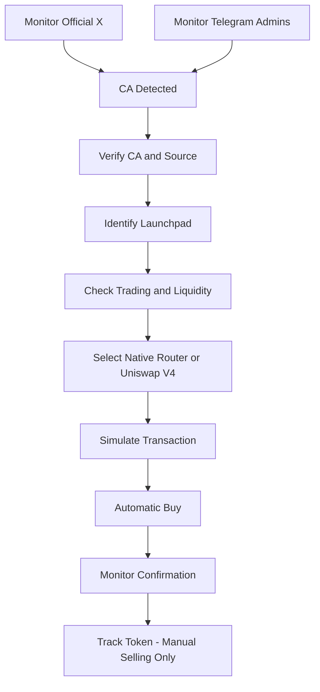

# Elysium Ultra-Fast Sniper – Configuration Document

Authoritative operator document for the Elysium mainnet sniper. Runtime defaults live in `config/elysium_sniper.py` and `config/settings.py`.

### 1. Network configuration

| Parameter        | Value           |
| ---------------- | --------------- |
| Network          | Elysium Mainnet |
| Chain ID         | 99901           |
| Gas token        | HYPE            |
| Execution target | 1–5 seconds     |
| Trading mode     | Automatic buy   |
| Selling mode     | Manual only     |

### 2. Monitoring configuration

| Parameter              | Value                       |
| ---------------------- | --------------------------- |
| X monitoring           | Primary                     |
| Telegram monitoring    | Secondary                   |
| X CA detection         | Enabled                     |
| Telegram CA detection  | Enabled                     |
| Admin verification     | Required                    |
| Normal member CA       | Ignore                      |
| Official documentation | Primary verification source |
| Duplicate CA detection | Enabled                     |

### 3. Buy configuration

| Parameter              | Default           |
| ---------------------- | ----------------- |
| Buy amount             | 1 HYPE (proposed) |
| Maximum slippage       | 5%                |
| Maximum buy tax        | 2%                |
| Minimum liquidity      | $100              |
| Gas strategy           | Dynamic / Fast    |
| Transaction simulation | Enabled           |
| Honeypot check         | Enabled           |
| Duplicate purchases    | Disabled          |

### 4. Launchpad execution

* BOXA – Native router adapter.
* Kleos – Native router adapter.
* Eleos – Native router adapter.
* ElysPump – Native router adapter.
* Ascend – Native router adapter.
* Uniswap V4 – Direct swap adapter.

The bot selects the fastest valid route based on the actual pool, router and launch mechanism.

### 5. Selling configuration

| Feature        | Setting             |
| -------------- | ------------------- |
| Automatic TP   | OFF                 |
| Automatic SL   | OFF                 |
| Trailing stop  | OFF                 |
| Automatic sell | OFF                 |
| Manual sell    | ON                  |
| Emergency sell | Manual trigger only |

### 6. Technical architecture

Documented target stack:

* Node.js / TypeScript
* viem
* WebSocket RPC
* Multiple RPC endpoints
* Redis – live monitoring and queue
* PostgreSQL – project and transaction records
* Telegram Bot API
* X monitoring integration

**This repository implements the same workflow in Python** (async SQLAlchemy, Redis, Telegram Bot API, RapidAPI X, launchpad adapters). A TS/viem rewrite is optional and not required for current operation.

### 7. Execution workflow

